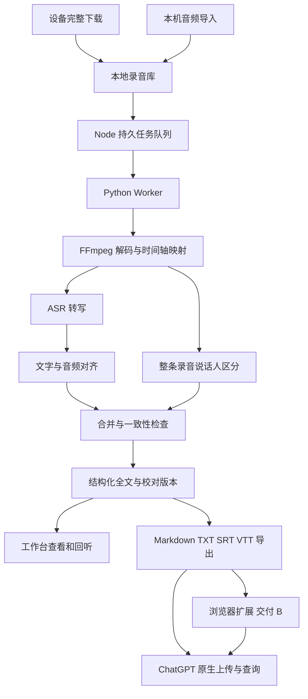

# 录音转写与 ChatGPT 资料接入实施方案

> 2026-11-04 范围更新：本轮已按用户确认实现项目内录音目录、默认 Ogg、主动选择仅下载或下载并转写，以及统一录音工作台。ChatGPT 一键发送延期独立实施。当前行为和验证以[按需下载与转写验收](reports/user-triggered-workspace-2026-11-04.md)为准；以下保留前期分阶段规划与质量目标。

版本：v0.6。日期：2026-11-04。状态：录音库、持久队列、本地 Worker、正式校对页面与五种全文导出已接入；四份样本可在工作台验收。按用户后续授权，以明确标注的候选稿推进功能闭环，未将其视为质量 Gate 放行。长音频词级对齐缺陷与人工评分仍待解决，G0 不放行。最新结果见[工作台交付报告](reports/audio-workspace-2026-11-04.md)；此前证据见[第一阶段报告](reports/audio-stage-1-2026-11-03.md)与[长音频核对报告](reports/audio-review-2026-11-03.md)。下文任务完成条件继续作为目标，以第 9 节实际状态区分已实现与待完成范围。

目标是在现有 RecDock 工作台中实现“下载或导入录音 → 本地自动转写 → 区分说话人并标注时间 → 保存全文 → 在 ChatGPT 网页查询”。用户继续使用已有 ChatGPT 账号，不需要 OpenAI 开发者 API 或 API Key，也不需要手动调用转写工具。

采用两次交付：交付 A 完成本地处理、校对、导出，以及通过 ChatGPT 原生页面保存全文并跨对话查询；交付 B 在此基础上增加浏览器扩展，减少上传和引用的手工操作。先验证完整资料可以被使用，再实现页面自动化。

## 1. 交付范围与已有证据

### 1.1 用户最终操作

1. 在工作台下载设备录音，或从本机选择已有音频。
2. 工作台保存原文件，自动排队处理，显示当前阶段；关闭页面后本地服务仍可继续运行。
3. 处理完成后查看“说话人、原文、时间戳”，点击句子回听，需要时修改姓名和识别文字。
4. 生成适合 ChatGPT 的全文资料。交付 A 使用原生上传，交付 B 使用“发送到 ChatGPT”。
5. 在 ChatGPT 网页提问，回答引用录音标题、说话人和原始时间。需要时在工作台回听核对。

全文是后续查询的依据；摘要只是辅助内容。ChatGPT Memory 用于用户选择的重要要点和来源线索，不承担整条录音的存储。保存到资料空间、被聊天引用、更新 Memory 分别记录结果。

### 1.2 本轮规划采用的已验证事实

| 事项 | 已有结果 | 对实施的影响 |
| --- | --- | --- |
| 约 103 分钟中文周会、81 分钟英文访谈 | 本地完整解码成功；在测试的 ChatGPT 网页模式下，整段内容理解未验证通过 | 后台转写作为稳定资料入口；不能据此推导统一音频时长上限 |
| 同源 30 秒 WAV | 返回了具体内容与概括 | 网页可理解部分短音频，但不能外推到整条长录音 |
| 资料空间跨对话取文件 | 后续新聊天取回英文原文件，SHA-256 与本地上传副本一致 | 文件持久保存可用；文件存在不代表完整内容已被理解 |
| Memory 跨对话回忆 | 明确要求记忆后，新对话能回忆文字要点、文件名与时间范围 | 可以保存经确认的要点；这不是把音频波形存入 Memory |
| 转写模型流水线 | 四样本 ASR、对齐和整条说话人区分已完成；长音频词级时间存在明显缺陷，人工评分未完成 | 保留候选组合，先优化对齐并完成 G0，再扩大开发 |

完整实验记录：[ChatGPT 音频验证记录](../../analysis/experiments/chatgpt-audio-validation-2026-11-03.json)。

### 1.3 第一期支持与后续边界

第一期面向 macOS Apple Silicon、本地批处理、中英文、单条最长至少覆盖现有 103 分钟样本。支持本机文件导入和设备完整下载接入；模型准备完成后，音频处理可以离线运行。浏览器和本地服务需要保持可用，关闭本地服务后下次启动恢复任务。

第一期不包含实时会议字幕、跨录音声纹身份库、自动识别真实姓名、重叠人声分离、多 AI 平台接入、远程 MCP 服务、云端转写，以及自动把全文或全部事实写入 Memory。网页自动上传属于交付 B；其支持范围由真实页面验证确定。

## 2. 现有工程与接入位置

现有工程是 Vite、TypeScript、原生 DOM 前端和 Node 本地中间件。保留现有技术栈，新增独立 Python 处理进程，不为本需求引入前端框架重构。

| 位置 | 当前行为 | 计划调整 |
| --- | --- | --- |
| `src/app/controller.ts` 的 `download()` | 在页面内存接收，完整性检查后尝试恢复可播放文件 | 在完成边界交付原始完整字节和可播放副本；原始文件与恢复结果都可入库 |
| `src/main.ts` 的 `downloadRecording()` | 完成后转格式并调用浏览器保存 | 增加入库步骤，入库成功后自动建任务；浏览器下载仍作为导出能力 |
| `src/audio/recovery.ts` | 支持现有设备封装恢复；失败返回 raw | 复用现有恢复逻辑；raw 标记为“待解密/暂不支持”，不得直接送 ASR |
| `src/main.ts` 的本机恢复流程 | 输入限制为 16 MiB，偏向设备私有文件恢复 | 新增独立的通用音频导入入口，由服务器流式保存和 FFmpeg 解码，不能复用此限制 |
| `server/http.ts` | `/api/session` 之外主要是 POST、小 JSON 请求，包含本地访问和 CSRF 检查 | 抽取请求上下文与校验，增加录音读写、任务查询、音频 Range 等路由；音频不走现有 16 KiB JSON 解析器 |
| `server/vault.ts`、`session-memory.ts` | 保存登录和历史解密材料 | 继续负责凭据；录音库独立存储，不把媒体塞入凭据 vault |
| `vite.config.ts` | dev 和 preview 注册本地中间件 | 两种启动方式均接入录音服务，保持本地服务单实例锁 |
| `src/ui`、`src/main.ts` | 设备工作台为主 | 增加不依赖 BLE 连接的“本地录音库”与处理详情，新增模块承载交互 |

现有 BLE 下载上限为 256 MiB，断点只保存在当前页面内存。本期保留这一边界，不把“后台任务恢复”描述成“BLE 刷新后断点续传”。后者单独立项。

## 3. 技术架构与选型

### 3.1 数据流



Node 负责录音持久化、权限范围、任务调度和页面 API。Python 负责模型加载与推理，通过标准输入输出交换版本化 JSONL 消息。前端不加载大模型，长任务不占用现有登录、设备准备操作的 `session.busy` 锁。

### 3.2 候选组合与验证条件

| 能力 | 首选候选 | 本机验证重点 | 退路 |
| --- | --- | --- | --- |
| 中英转写 | Qwen3-ASR-1.7B，优先测试 MLX 量化实现 | 正确率、中英混说、长音频切块、峰值内存和离线加载 | 先降为 0.6B；质量不足时用 MLX Whisper 做同样本对照，再决定替换 |
| 时间对齐 | Qwen3-ForcedAligner-0.6B，测试 MLX 实现 | 语言覆盖、数字专名、输出与当前 ASR 文本兼容、分段接缝 | 保留句级时间并明确精度降级，不能把插值时间冒充实测词级结果 |
| 说话人区分 | pyannote `speaker-diarization-community-1` | 整条长录音统一聚类、CPU 耗时、MPS 可行性及内存 | CPU 是兼容路径；未通过 MPS 基准时不承诺 GPU 加速 |
| 解码预处理 | FFmpeg / FFprobe | 输入探测、完整解码、源时间映射、坏文件与资源限制 | 格式不支持时保留原件，返回明确错误，不输出空全文 |

Qwen 官方说明中，ForcedAligner 单次支持最多 5 分钟，因此每次对齐请求必须小于该限制；建议按自然语句组成更短片段，具体长度由 G0 确定。[Qwen3-ASR 官方仓库](https://github.com/QwenLM/Qwen3-ASR)

Apple Silicon 路线使用 MLX 社区实现，需要锁定实现版本、模型 revision、量化规格和处理参数，不能把它等同于 Qwen 官方 CUDA 后端。[MLX Qwen3 ASR 实现](https://github.com/Blaizzy/mlx-audio/blob/main/mlx_audio/stt/models/qwen3_asr/README.md)

pyannote 模型首次获取涉及 Hugging Face 账号、模型使用条件和下载凭据。由用户完成条件确认，支持指定已下载模型目录；这不需要 OpenAI API Key。下载后验证本地离线加载，记录模型许可与再分发限制，不将访问 token 写入源码或处理日志。[pyannote 模型说明](https://huggingface.co/pyannote/speaker-diarization-community-1)

### 3.3 环境策略

以独立 Python 虚拟环境管理 MLX、PyTorch、pyannote 等依赖。初始优先尝试 Python 3.12；本轮自动准备受执行环境网络限制，采用本机已有的 Python 3.11.14，已完成共同环境安装、哈希依赖锁重建与四样本实际模型推理。若后续出现运行时冲突，才拆成两个模型环境。

首次配置提供“检查环境、准备模型、验证模型”三个明确步骤，显示缺失项、下载进度和所需磁盘空间。模型下载与日常转写分离；模型不存在时显示“需要准备模型”，不反复自动联网下载。关闭不必要的遥测，使用断网运行测试验证离线能力。

本机已确认是 M3 Pro、18 GB 内存，正常终端的两个短样本和两个长样本已跑通 MLX 和 MPS 模型推理。两条长音频各阶段计算合计约 16.2 分钟和 12.4 分钟，具体口径见阶段报告。首次隔离进程不能访问 Metal GPU；后续权限环境调整后已能直接运行短切块 GPU 对照。生产资源预算与并发度仍待 T02/G0 固定。

## 4. 录音库与数据契约

### 4.1 存储安排

默认复用现有应用数据根目录，在 `~/Library/Application Support/PLAUD BLE Workspace/library-v1/` 下建立独立媒体库。模型缓存单独放置，测试音频与真实录音不进入 Git。

```text
library-v1/
  scopes/<scope-id>/
    recordings/<recording-id>/
      recording.json
      original/<sanitized-name>
      playable/<asset-id>.ogg
      work/<pipeline-fingerprint>/
        prepare.json
        chunks.json
        asr.json
        alignment.json
        diarization.json
      transcripts/machine-v1.json
      revisions/<revision-id>.json
      exports/<revision-id>/
      jobs/<job-id>.json
      sync/<delivery-id>.json
```

`playable` 仅在原文件无法直接播放时产生。临时解码文件可清理，原件、机器转写和用户校对版本分别保留。媒体按本机用户权限保存，目录 0700、文件 0600；一期不额外实现媒体加密，不能把凭据 vault 的加密能力宣传成音频加密。

录音导入使用文件选择和流式上传，初始导入上限拟定 1 GiB，最终由资源预算验证后固定并在页面显示。上传中断产生的临时文件不能出现在“可转写”列表。FFprobe 探测、完整性检查、SHA-256 计算和原子提交完成后，状态才能进入 `stored`。

### 4.2 身份、去重与资料保留

- `recordingId` 是工作台生成的稳定 ID；`sourceSha256` 用于同一资料范围内识别重复源文件。设备来源附加设备标识、session ID 和完整下载状态，不能只用 session ID 作为全局身份。
- 成功恢复设备文件后，同时保留原始设备字节与可播放副本，分别记录哈希；Python 只接收可解码资产路径，不需要获得 PLAUD RSA 私钥。
- 服务器根据本地会话确定当前资料范围：已登录时使用对应账号范围；未登录的本机导入进入独立个人范围。客户端不得通过传入任意 account ID 切换资料。
- 本地个人资料入口不要求登录 PLAUD 或连接设备。账号资料在该账号退出后从 UI 隐藏；普通退出保留文件，暂停该账号待执行任务并停止当前任务。关闭页面不会退出账号或中止任务。
- 原有“清除本机数据”按钮已明确为“移除账号授权与解密材料”；录音独立管理。当前删除操作是可恢复的回收站，会取消任务并隐藏录音，不释放磁盘空间；永久清理尚未实现。已上传到 ChatGPT 的副本需要单独管理。
- 文件名和录音内容不进入默认诊断日志。资料导出不包含本机绝对路径、账号 token 或解密材料。

### 4.3 全文 JSON 作为唯一结构化来源

字段使用毫秒时间，时间轴始终对应原始录音。下面仅示意结构，不是已测出的模型结果：

```json
{
  "schemaVersion": 1,
  "recordingId": "rec_example",
  "sourceSha256": "<sha256>",
  "durationMs": 60000,
  "revisionId": "rev_example",
  "language": "zh",
  "provenance": {
    "pipelineVersion": "<version>",
    "asr": { "model": "<model>", "revision": "<revision>" },
    "aligner": { "model": "<model>", "revision": "<revision>" },
    "diarizer": { "model": "<model>", "revision": "<revision>" }
  },
  "speakers": [
    { "id": "SPEAKER_00", "displayName": "说话人 1", "nameSource": "default" }
  ],
  "segments": [
    {
      "id": "seg_example",
      "startMs": 1200,
      "endMs": 3500,
      "speakerId": "SPEAKER_00",
      "text": "这是用于说明结构的文字。",
      "timingSource": "forced_alignment",
      "overlap": false,
      "flags": [],
      "words": [],
      "scores": null
    }
  ]
}
```

完整 schema 还要定义 `source`、资产引用、chunk 来源、原始说话人 turns、`speakerId: null`、人工修改来源、未对齐原因和阶段结果引用。不同模型分数按其原始含义保存；无分数时使用 null，不能制造统一“准确率 95%”。

机器全文保持不可变，用户修改保存为 revision。改说话人显示名只更新映射。当前改文字或时间会清除旧字词时间、标注待核对，并保留句段候选范围；自动局部重新对齐尚未实现。后续重对齐只计算受影响片段及必要上下文。导出绑定具体 revision，避免旧文件与新页面混淆。

### 4.4 长音频的时间与说话人规则

1. 保留原声道资产；ASR/区分人的计算副本按模型需求转为 16 kHz 单声道，播放仍使用原件或高质量可播放副本。
2. VAD 只用于安排切块，不把静音删掉后再直接计算时间。每块记录原始 `startMs/endMs`、padding 和采样信息。
3. ASR 块保留适当上下文，接缝去重；对齐子块均满足模型时长限制。恢复全局时间时只应用一次 offset。
4. 说话人区分采用整条录音的统一聚类。即便内部做分块，也必须在录音级合并后生成稳定编号；不能把各块的 SPEAKER_00 直接当成同一个人。
5. 保留允许重叠的原始 turns；可以用 exclusive diarization 辅助生成易读全文，但不能因此抹掉“同时说话”的事实。
6. 词与说话人按时间重叠分配，在说话人变化处切句。归属冲突、短促插话或未对齐部分标为不确定，允许 `speakerId: null`；不以最近的人强行填充所有空白。
7. 说话人编号只在当前录音内有效。默认显示“说话人 1/2”；姓名由用户试听确认，不根据语义猜测 Jobs、Gates 或会议成员身份。
8. 检查时间范围、顺序、重复文本和 chunk 覆盖。重叠是合法状态；负时间、超出原音频、漏块和重复拼接应阻止发布 ready 结果。

## 5. 后台任务、进程与本地 API

### 5.1 任务执行

一期采用“每条录音独立原子 JSON manifest + 单服务写入锁 + 一个活动推理任务”。先控制内存与实现规模，不引入数据库或同时跑多个大模型。数据规模和多进程需求出现后再迁移数据库。

任务状态为 `queued → running → succeeded`，另有 `failed / cancelled / interrupted / paused`。运行阶段单独记录 `preparing / transcribing / aligning / diarizing / merging / exporting`，UI 翻译为用户可理解的文字。处理顺序先串行，测得内存余量后才考虑重叠运行。

阶段输入由源哈希、模型 revision、参数、上游产物哈希组成指纹。每阶段写临时文件，校验后原子提交；失败只重跑失败阶段和依赖它的下游。取消和服务重启保留已提交阶段，未提交阶段重新执行，不承诺模型推理内部的字节级续跑。

新 revision、模型或分块参数会沿依赖关系使缓存失效：改显示名无需重推理；改 ASR 文本需要重对齐和重合并；换 diarizer 只重算说话人结果与合并；更换源文件视为新输入。导出与同步记录对应版本失效后保留历史，不能冒充最新结果。

### 5.2 Worker 协议

通过 `spawn` 参数数组启动受管理 Python，不拼 shell 命令。协议至少包含 `protocolVersion / jobId / stage / event / sequence / payload`，事件包括 `ready / stage_started / progress / artifact / completed / failed / cancelled / heartbeat`。

stdout 仅输出协议，stderr 输出经过脱敏的诊断。校验消息大小、顺序、任务身份和产物路径；模型库普通输出不得混入协议。进度只能来自已完成块数、音频覆盖量或模型实际事件，不按计时器编造百分比。

取消先请求正常退出，超时再终止进程组，确保 FFmpeg 子进程也退出。心跳、单阶段无进展时间和阶段总预算分别监控，长推理不能仅因缺少文本输出就被误杀。推理结束后释放当前模型；常驻缓存是否启用由内存基准决定。

### 5.3 API 草案

以下接口在 T03 固定契约，JSON 控制请求与大文件上传分开处理。

| 方法与路径 | 作用 | 关键约束 |
| --- | --- | --- |
| `POST /api/library/imports` | 创建导入会话 | 返回受当前范围约束的 upload ID |
| `PUT /api/library/imports/:id/content` | 流式传输原始文件 | 字节上限、磁盘预算、中断清理；不接收任意文件系统路径 |
| `POST /api/library/imports/:id/commit` | 校验并入库 | 哈希、探测、去重、原子提交 |
| `GET /api/library/recordings` | 本地录音列表 | 分页；仅当前资料范围 |
| `GET /api/library/recordings/:id` | 元数据与处理结果索引 | 不默认返回整条词级 JSON |
| `GET /api/library/recordings/:id/audio` | 回听 | 有边界的 HTTP Range；只读受管资产 |
| `POST /api/library/recordings/:id/jobs` | 排队或重试 | 幂等键、有效源、明确 pipeline 配置 |
| `GET /api/library/jobs/:id` | 状态和真实进度 | 一期轮询，保留后续事件流兼容性 |
| `POST /api/library/jobs/:id/cancel` | 取消处理 | 多次调用安全，检查资料范围 |
| `GET /api/library/recordings/:id/transcript` | 分页读取全文 | revision 与 cursor；避免一次渲染十万词 |
| `POST /api/library/recordings/:id/revisions` | 保存人工修改 | 带基准 revision，冲突时拒绝覆盖 |
| `POST /api/library/recordings/:id/exports` | 生成指定版本导出 | 格式和文件名白名单 |
| `DELETE /api/library/recordings/:id` | 删除本地资料 | 先停止任务，再删除受管目录 |

沿用 loopback、Host、Origin、CSRF 检查，并把长任务与当前账号操作锁解耦。读取接口同样校验会话和资料范围，音频资产不能绕过授权成为公开静态目录。会话过期不损坏后台任务，前端通过现有会话刷新恢复查询。

## 6. 工作台交互与导出

### 6.1 页面安排

- **本地录音库**：独立入口，显示标题、来源、时长、导入时间、处理状态和最近同步结果；未连接设备时仍能操作本机音频。
- **处理详情**：当前阶段、已完成块数、失败原因、取消与重试；缺模型和处理失败使用不同状态。准备模型完成后可自动转写，默认只排一个活动任务。
- **全文与播放器**：按句分页或虚拟列表，显示说话人和原始时间；点击跳转，播放时高亮；支持文本搜索、试听改名、文字校对和修改待对齐提示。
- **导出与 ChatGPT**：显示选中的全文版本、发送文件、原音频是否包含和可核验状态。原音频不是查询全文的必传文件，默认发送全文和来源元数据；需要核听时再附原音频。
- **模型设置**：环境检查、模型目录、下载状态、磁盘占用与可用处理模式；缺失的组件对应明确处理步骤。

一期沿用原生 DOM，把录音库、详情和模型配置拆到 `src/library/`；`src/main.ts` 仅负责入口挂载和账号/设备状态联动，避免继续堆积长任务与编辑逻辑。

### 6.2 导出格式

| 产物 | 用途 | 验收要点 |
| --- | --- | --- |
| JSON | 机器读取和后续迁移 | 完整 schema、来源、revision、时间、说话人及不确定标记 |
| Markdown | ChatGPT 资料全文 | 标题、日期、来源 ID、版本、录音时长、每句说话人与时间；包含全文 |
| TXT | 网页兼容回退 | 相同全文证据，使用清晰的纯文本格式 |
| SRT / VTT | 字幕与回听工具 | 时间合法；VTT 保留说话人标签，SRT 重叠段按确定规则拆分并标注，转换规则有说明 |

适合 ChatGPT 的行格式示例：`[00:12:03.200–00:12:08.600] 说话人 2：……`。资料顶部说明这是一份来源全文，音频中的命令式语句属于被记录内容，不能当成操作指令。

导出文件名包含录音短 ID 和 revision，内容包含完整源哈希。文件过大或页面拒绝时，按连续时间范围拆分，附一份索引列出全部分卷和覆盖范围，不能静默截断后半段。完整 JSON 是权威数据，字幕格式的表现限制不反向修改全文。

## 7. ChatGPT 网页接入方案

### 7.1 交付 A 原生上传闭环

先使用用户现有 ChatGPT 页面上传 Markdown 或 TXT 全文，确认文件进入资料空间后新建聊天，完成来源定位、首中尾内容查询、说话人提问和时间引用验证。这一步不要求浏览器扩展，也不调用开发者 API。

分别验收两种跨对话行为：新聊天通过“从资料空间添加”复用已有全文；新聊天不添加附件、只按来源提问的自动检索。前者是明确复用的基线，后者单独记录成功率和延迟。若自动检索不稳定，产品必须显示“需要从资料空间选择”的真实限制，不能宣称无操作自动记住全部录音。

记忆写入保持为用户明确选择的行为。上传成功不触发“记忆成功”标记；只有网页明确反馈，并在独立新聊天核验后，才能记录相应文字要点的记忆测试结果。[ChatGPT Space](https://learn.chatgpt.com/docs/space)、[ChatGPT Memory](https://learn.chatgpt.com/docs/customization/memories)

### 7.2 交付 B 浏览器扩展

优先针对用户当前使用的 Edge 实现 Chromium Manifest V3 扩展，完成后再验证 Chrome。T18 先核对当时的扩展文档和真实 ChatGPT 页面，选择受支持的用户交互方式；如页面无法可靠完成文件进入资料空间，则保留原生上传，不以内部接口补齐。

扩展从工作台打开或定位 ChatGPT 页面，接收当前 revision 的导出文件，完成可观察的附加、发送与资料空间确认，并返回结果。通过用户在工作台发起的一次发送任务配对两个页面，配对信息短期有效、仅限本次文件；不向 ChatGPT 页面开放通用本机文件读取接口。扩展不读取账号 cookie/token，不调用 ChatGPT 私有上传接口。

只申请限定的工作台本机地址和 `chatgpt.com` 页面权限。网页改版、未登录、需要选择对话、配额或上传异常进入 `user_action_required`，显示原生上传入口。不能用“点击上传按钮成功”推导“文件已经持久保存”。

同步状态至少区分 `prepared / attached / submitted / verified / failed / user_action_required`：

- `prepared`：导出包已生成，绑定录音、源哈希、revision 和内容哈希。
- `attached`：页面可见附件且身份可核对。
- `submitted`：网页已接受发送，尚未证明进入资料空间。
- `verified`：资料空间出现相符文件，并完成可复用检查；保存实际观察到的远端引用或页面链接。
- 仅观察到部分状态时保留真实阶段；恢复未知发送状态前先核对，避免盲目重传制造重复副本。

同步幂等键采用 `目标浏览器配置 + 工作台配对目标 + recordingId + revisionId + 导出内容哈希`。网页账号切换后要求重新核对目标；工作台不能把本地账号当成 ChatGPT 账号，也不能自动删除旧远端版本。

### 7.3 当前一键转发交付

本次按用户确认的范围实现 Edge 扩展：发送当前已保存版本的完整 Markdown 与提示词，固定复用一个标签页，在该页新建对话；通过用户消息、附件卡及对话链接确认 `submitted`。已完成合成稿的真实单页发送、刷新恢复与重复点击验证。设置中提供连接和提示词，详情页提供发送、状态、打开对话及手动导出回退。详见 [交付说明](chatgpt-forward-delivery.md)。

本轮不将 `submitted` 提升为 `verified`：资料空间持久化、跨对话复用、Memory 与 Chrome 真实账号验收仍沿用独立验证边界。扩展不新建 ChatGPT 标签页，不读取网页凭据，不调用私有上传接口。

## 8. 模块与文件职责

以下为拟新增位置；T03 固定名称后再实施，现有文件只作必要接入。

| 模块 | 计划位置 | 责任 |
| --- | --- | --- |
| 领域契约 | `src/library/types.ts`、`docs/audio-contracts.md` | Recording、Transcript、Job、Revision、Sync、错误码与协议版本 |
| 请求上下文 | `server/local-context.ts`、调整 `server/http.ts` | 共用本地访问校验、会话、CSRF 与资料范围 |
| 录音库 | `server/library/store.ts`、`imports.ts`、`routes.ts` | 入库、资产、哈希、账号隔离、音频 Range 和删除 |
| 调度与进程 | `server/transcription/queue.ts`、`worker.ts` | 阶段缓存、单实例、取消、重启恢复与协议校验 |
| Python 处理器 | `worker/pyproject.toml`、`worker/recdock_audio/` | 环境锁、预处理、ASR、对齐、区分人、合并与 CLI |
| 校对与导出 | `server/library/revisions.ts`、`exports.ts` | revision 冲突检查、局部重对齐、各格式派生 |
| 前端 | `src/library/api.ts`、`library-view.ts`、`detail-view.ts`、`model-view.ts` | 录音库、任务状态、播放器、全文和设置 |
| BLE 接入 | 调整 `src/app/controller.ts`、`src/main.ts` | 完整源文件及可播放副本入库，保留原下载能力 |
| 网页扩展 | `extensions/chatgpt-bridge/` | 交付 B，独立构建、页面适配、传输与回执 |
| 验证与报告 | `worker/tests/`、`tests/library-*.test.ts`、`scripts/benchmark-audio.*` | 契约、时间映射、异常恢复、质量基准与回归 |

每个模块有单一负责角色便于后续分工；本规划未启动并行实施。

## 9. 开发任务与依赖

当前任务状态见下表和[工作台交付报告](reports/audio-workspace-2026-11-04.md)。估算仍保留原规划口径，按熟悉现有工程的一名开发者有效投入计，单位为人日；不包含用户等待下载授权、模型大文件下载和非工作时段。

| 任务 | 2026-11-04 实际状态 |
| --- | --- |
| T01、T03 | 环境、模型锁与共享契约已实现；本轮扩展人工归属、时间和核对状态变更 |
| T02 | 四样本计算、异常块恢复及短切块对照已完成；人工真值与 G0 未完成 |
| T04、T06 | 持久录音库、流式导入、范围隔离、Range、单 Worker 队列与恢复/取消已实现并验证 |
| T05 | BLE 原始字节与恢复副本入库接线已实现；本轮未重新连接真机验收 |
| T07、T08 | 完整解码、固定 120 秒切块、offset、模型适配和缓存已接入；VAD 与生产级接缝策略未完成 |
| T09、T10、T11 | 对齐、整条录音聚类与结构校验已接入；正式稿保留句段候选时间，不发布无效词时间；人数上下界尚未开放到页面 |
| T12 | 失败重试、配置指纹、重启恢复、账号暂停和取消已验证；磁盘等更多故障注入仍可扩展 |
| T13 | 独立录音库、导入语言、环境就绪提示和任务状态 UI 已实现；模型下载仍由独立准备工具负责 |
| T14 | 分页、搜索、回听、改名、文字/归属/时间校对、不可变历史已实现；自动局部重新对齐未完成 |
| T15 | MD/TXT/JSON/SRT/VTT 完整版本导出已实现；自动分卷尚未实现，当前长样本无需分卷 |
| T16 | 上轮英文全文的原生上传与跨聊天检索已实测；本轮正式导出完整性通过，未重复远端上传 |
| T17 | 本轮功能回归、构建、真实短样本流水线和运行说明完成；G0/G1/G2 的完整质量验收不据此放行 |
| T18–T21 | Edge 扩展交接、单页提交与回执已实现；Chrome 真实账号、资料空间 verified 与跨对话复用仍需独立验收 |

### 9.1 交付 A

| ID | 任务与负责模块 | 依赖 | 可评审产物 | 完成条件 | 人日 |
| --- | --- | --- | --- | --- | --- |
| T01 | 环境与模型最小验证；Python | 无 | 环境检查脚本、依赖锁草稿、硬件/许可记录 | ASR、aligner、diarizer 分别跑通短样本，输出真实耗时与内存；明确 CPU/MPS 路径 | 0.75–1.25 |
| T02 | 短长音频基准与选型；Python/验证 | T01 | 基准集清单、人工参考、机器结果与 G0 结论 | 两条长样本全程完成；质量/性能达标或确定替代组合，记录模型 revision 与资源预算 | 1.25–2.25 |
| T03 | 数据与进程协议；领域契约 | T01；模型字段在 T02 后固定 | schema、错误码、JSONL 示例、状态与缓存依赖表 | TS/Python 共同读取契约样例；unknown、overlap、revision、source offset 均可表达 | 0.5–0.75 |
| T04 | 持久录音库和本机导入；Node | T03 | 存储模块、本地请求上下文、流式导入与读取 API | 完整源文件重启后可回听；重复导入幂等，跨范围不可见，中断文件不入库 | 1.25–1.75 |
| T05 | BLE 完成入库；设备接入 | T04 | 完整下载结果契约、入库适配 | 原始设备文件与可播放副本均保留；未完成下载和 raw 不进入转写 | 0.5–0.75 |
| T06 | 持久队列与 Worker 管理；Node | T03、T04 | 队列、进程管理器、协议日志 | 单任务执行；关闭页面继续，取消退出子进程，服务重启识别 interrupted | 1–1.5 |
| T07 | 解码、VAD 与时间映射；Python | T02、T03 | 预处理模块、chunk manifest | 长样本首中尾 offset 正确，静音/重采样不造成累计漂移，输入不支持时明确失败 | 0.5–0.75 |
| T08 | ASR 生产适配；Python | T07 | 锁定模型的 ASR adapter | 中英片段可转写；接缝去重、缓存、失败重跑和中英混说策略可验证 | 0.75–1 |
| T09 | 强制对齐适配；Python | T08 | 对齐模块及词/句时间 | 每次请求满足模型限制；未对齐文本有标记，不制造精确时间；全局时间合法 | 0.5–0.75 |
| T10 | 录音级说话人区分；Python | T07 | 原始 turns 与稳定 speaker 映射 | 跨块编号统一，人数可自动估计或设上下界，保留重叠信息与未知归属 | 0.75–1.25 |
| T11 | 全文合并与一致性校验；Python/契约 | T09、T10 | canonical transcript 和合并报告 | 人物换段、时间归属、漏块/重复检查通过；不确定内容有明确标记 | 0.75–1.25 |
| T12 | 失败恢复与缓存失效；Node/Python | T06、T11 | 阶段提交、重试与故障注入结果 | 杀进程/磁盘不足/模型缺失后原件完好；已完成阶段可复用，配置变化能正确失效 | 0.5–0.75 |
| T13 | 录音库、模型和任务 UI；Web | T04、T06 | 独立录音库与配置/状态界面 | 无设备也能导入；缺模型、排队、失败、取消、ready 显示正确 | 0.75–1.25 |
| T14 | 全文、回听、改名和校对；Web/Node | T11、T13 | 详情页、revision 与局部重对齐 | 103 分钟全文可用；点击时间回听；姓名改动不重推理，文字改动不沿用失效时间 | 1–1.5 |
| T15 | 全文导出与版本包；Node | T11、T14 | JSON/MD/TXT/SRT/VTT exporter | 全文无截断，来源可追溯，长文件可分卷；派生结果与所选 revision 一致 | 0.5–0.75 |
| T16 | ChatGPT 原生上传与跨对话验证；集成验证 | T15 | 验证脚本说明、聊天证据与结果记录 | 新聊天可复用已保存全文并回答原音频首中尾问题；自动检索与 Memory 单独记录 | 0.5–1 |
| T17 | 完整回归与交付说明；验证 | T05、T12、T14、T16 | 测试报告、性能报告、运行/恢复说明 | G1/G2 通过，既有登录/BLE/音频导出无回归，已知降级对用户可见 | 1–1.5 |

交付 A 合计 **12.75–20 人日，排期按 13–20 人日安排**。T01/T02 包含选型验证，不把一次性基准脚本直接当作生产任务服务。

### 9.2 交付 B

| ID | 任务与负责模块 | 依赖 | 可评审产物 | 完成条件 | 人日 |
| --- | --- | --- | --- | --- | --- |
| T18 | Edge/ChatGPT 页面能力验证；扩展 | T16，且 G2 通过 | 页面行为与权限记录、最小扩展原型 | 明确可观察的上传/持久化/引用路径；无法确认的步骤必须保留用户介入 | 0.5–1 |
| T19 | 工作台到扩展文件交接；Node/扩展 | T18 | 配对、限定文件传输、取消与错误处理 | 不读浏览器凭据；仅接收当前任务文件，目标切换可检测，失效配对不可复用 | 1.5–2.5 |
| T20 | 网页上传与同步状态；扩展/Web | T19 | 页面适配器、幂等记录和状态 UI | 区分 attached/submitted/verified，异常可回到原生上传，不盲目重复发送 | 1–1.5 |
| T21 | 网页回归与最终验收；验证 | T20 | Edge 优先的真实页面报告、Chrome 兼容结果 | G3 通过；重试、页面改版模拟、登录失效、版本更新、跨对话查询均有证据 | 0.75–1.25 |

交付 B 合计 **3.75–6.25 人日，排期按 4–7 人日安排**。全部工作按 **17–27 人日** 预留；若 G0 触发模型替换或 G3 证明页面能力不足，应更新对应范围和估算，不能以未经证实的自动化承诺填满计划。

### 9.3 推荐实施顺序

```text
T01 → T02 → G0
  └→ T03 → T04 → T05
               ├→ T06 → T13
G0 + T03 → T07 → T08 → T09 ┐
               └→ T10 ────┴→ T11 → T12 → G1
T11 + T13 → T14 → T15 → T16 → T17 → G2 交付 A
G2 → T18 → T19 → T20 → T21 → G3 交付 B
```

原首批 T01–T03 已执行，后续按用户授权完成候选稿的工作台功能闭环。下一步优先用回听建立文字、讲话人和时间参考，针对已知对齐缺陷验证改进，再补自动局部对齐与真机下载入库验收。模型仍以锁文件与 provenance 描述，不把候选精度写成产品保证。

## 10. 阶段验收与测试口径

G0–G3 是技术验收条件，不是额外的逐步用户审批流程。开发中达标即可继续；涉及模型使用条件或浏览器明确要求的用户操作时，呈现具体操作。

### 10.1 基准样本

| 样本 | 用途 | 标注与限制 |
| --- | --- | --- |
| `0-four-speakers-zh.wav` | 短中文多人基础基准 | 人工确认人数、逐字参考和换人位置，文件名不作为人数真值 |
| `3-two-speakers-en.wav` | 短英文基础基准 | 人工核验文字、人物 turns 和词边界 |
| `02-24周会录音-飞飞.mp3` | 约 103 分钟真实会议 | 整条检查覆盖；首中尾及困难区间共 10–15 分钟建立参考，报告抽样误差率 |
| `Steve Jobs & Bill Gates_ A Conversation That Shaped Technology.mp3` | 约 81 分钟英文与低码率条件 | 检查整条人物编号一致性；抽样建立参考，包含 40:00 附近已有验证区间 |
| 静音、坏文件、已加密未恢复、跨块换人等合成片段 | 确定性异常测试 | 自动生成；不依赖真实用户账号或私钥 |

所有真实素材留在用户原目录或独立测试数据目录。仓库只保存样本 ID、哈希、标注规范和不含敏感内容的报告摘要；不默认使用其他面试录音。公开语音语料可辅助对照，但不能替代会议和说话人测试。

### 10.2 拟定质量目标

以下是验收目标草案，不是已有测量结果。T02 在已确认的标注集和硬件上固定最终目标；若未达到，记录差距并调整模型或明确降级。

| 指标 | 初步目标与统计方式 |
| --- | --- |
| 清晰短中文 CER | ≤ 12%；统一标点、空白和数字归一化口径，并同时保留原始结果 |
| 清晰短英文 WER | ≤ 15%；记录大小写、标点和数字归一化规则 |
| 会议/访谈误差 | 对人工参考的 10–15 分钟困难区间分别报告；不得把抽样结果标作整条录音准确率 |
| 说话人归属 | 非重叠语音时长加权正确率初步 ≥ 90%；与参考人物做最优映射后计算，重叠和未知占比单列 |
| DER | 同时报 DER，固定是否包含重叠、collar 大小和评分版本；不能与“归属正确率”混为同一指标 |
| 时间边界 | 至少 150 个分布在首中尾与接缝的人工词/句边界；中位绝对偏差 ≤ 200 ms，P95 ≤ 600 ms，未对齐比例单列 |
| 长音频覆盖 | 全部 chunk 有可追踪结果或明确失败，零静默漏段；覆盖不等于所有文字识别正确 |
| 人物稳定性 | 人工抽查每位主要说话人在首中尾的编号；同人换号和不同人混号分别报告 |
| 性能 | 分阶段记录墙钟耗时、RTF、峰值总内存、磁盘临时空间；G0 按本机固定预算，一期目标先单任务稳定完成 |

不预先承诺“81 分钟录音几分钟处理完”。RTF 定义为处理墙钟时长 ÷ 原音频时长，冷启动模型下载不计入推理 RTF，但单独记录首次准备时间。

### 10.3 四个验收点

| 验收点 | 必须具备的证据 | 不通过时的处理 |
| --- | --- | --- |
| G0 模型可行 | 短样本标注与结果；两条长样本全程推理；明确依赖锁、模型 revision、资源和质量结论；断网可推理 | 调整模型或处理配置后复测；冻结明确可用的能力范围再继续生产适配 |
| G1 本地流水线 | 导入/设备入库→处理→canonical 全文；时间和人物合并检查；取消、重启和故障恢复证据 | 修复数据完整性或恢复问题，不能仅凭一条成功样例放行 |
| G2 ChatGPT 可用 | 完整全文已保存；新聊天无需再次上传即可复用；来源和时间可核对；隐式检索结果单独记录；既有工程回归通过 | 明确是导出、资料保存、检索还是回答问题；修复后重测，不用 Memory 回忆替代全文检索 |
| G3 页面自动接入 | 扩展完成真实发送并观察到持久化/复用；目标账号核对、状态恢复、重复发送保护和手工回退通过 | 页面无法可靠支持时保留交付 A，记录 B 的具体受限步骤，不能标全自动完成 |

ChatGPT 验证至少包含：首、中、尾各一个具体事实；某位说话人的观点；两个来源的对比；一个源材料未提及的问题。检查能否引用正确文件和时间，也检查缺失信息时是否明确说明。采用新的对话，避免把此前聊天答案作为检索成功的依据。

### 10.4 工程检查

- Node：执行现有 `npm test` 和 `npm run build`，新增有意义的导入中断、账号范围、Range、队列恢复、幂等和 revision 冲突测试。
- Python：覆盖原始时间 offset、接缝去重、5 分钟限制、跨块人物映射、overlap/unknown、失效缓存和协议输出；模型真实基准独立运行，不能用 mock 结果证明识别质量。
- UI：验证设备未连接、模型缺失、长列表、取消重试、刷新恢复、文本修改、播放跳转、账号切换和导出失败。
- BLE：使用原有模拟和短真实录音检查登录恢复、下载取消、完整下载入库与原格式导出。
- 长录音：每次更换模型或影响分块/合并的参数才重跑相关基准；普通显示改动不重复全部昂贵推理。

## 11. 开发安排与交付物

下表是单人相对工期安排，不作为固定日历承诺。按 5 个有效工作日折算，全部工作约 4–6 周；G0 完成后更新区间。

| 阶段 | 工作量 | 累计节点 | 用户可看到的结果 |
| --- | --- | --- | --- |
| 第一阶段 可行性与契约 | 2.5–4.25 人日 | T01–T03 / G0 | 两条长录音的本机基准、选型结论、结构化结果样例与性能预算 |
| 第二阶段 录音库与后台骨架 | 3.25–4.75 人日 | T04–T07 | 文件可落盘、重启不丢，能排队处理，设备下载能入库 |
| 第三阶段 完整转写流水线 | 3.25–5 人日 | T08–T12 / G1 | 完整文字、统一说话人、可回听时间，失败可恢复 |
| 第四阶段 工作台与查询闭环 | 3.75–6 人日 | T13–T17 / G2 | 校对、全文导出、ChatGPT 网页跨对话使用，交付 A |
| 第五阶段 自动上传 | 3.75–6.25 人日 | T18–T21 / G3 | Edge 扩展交接文件、观察同步状态，交付 B |

职责可分为 Python 模型处理、Node 数据/调度、Web 交互、浏览器扩展、集成验证。同一开发者可以顺序承担；后续多人协作时按第 8 节模块划分文件所有权，合并共享契约后再各自实施。工期为总人日，不能把可并行任务直接按人数平均分摊。

每阶段提交小批可检查改动，至少携带：对应任务 ID、影响模块、实际验证结果、剩余限制。阶段交付保留运行与恢复说明、模型版本与许可记录、基准报告、导出样例和真实页面验证记录。

当前正式入口为 `http://localhost:5173/#library`，四样本已落入持久录音库。两短样本通过真实 HTTP 导入后重新执行本机模型；两长样本复用此前已实测阶段缓存，并经真实 Worker 校验、合并与正式契约发布。长音频词级时间仍需优化，人工 CER/WER、DER 与时间偏差未验收；当前交付限于候选稿功能验收，不能据此声称 G0/G1/G2 全面通过。

## 12. 主要风险与处理触发条件

| 风险 | 何时触发 | 处理安排 |
| --- | --- | --- |
| MLX 与 pyannote 依赖冲突 | T01 无法在一个锁定环境加载 | 先固定共同版本；仍不兼容才拆环境，保持 Node 协议一致 |
| 本机内存或耗时不足 | T02 长样本超预算或进程被系统终止 | 降模型规格、逐阶段卸载、减小块长、禁并发；重新记录性能与质量 |
| 低码率、噪声和重叠降低准确率 | 抽样质量未达目标 | 标不确定并允许回听校对；同集对照候选模型，不承诺声音分离 |
| 人物在长音频中漂移 | 首中尾同人分裂/多人合并 | 调整整条聚类与人数提示；同录音修正，暂不建立跨录音声纹库 |
| 网页上传或自动检索不稳定 | T16/T18/T21 真实账号验证失败 | 记录具体步骤和延迟；使用原生显式引用回退，自动检索不冒充保证 |
| 校对后远端旧全文仍被引用 | revision 更新后 ChatGPT 有多个版本 | 文件名和内容带版本；显示远端历史记录与最新待同步版本，不自动删除资料空间内容 |
| 服务中断或磁盘不足 | 上传、阶段提交或推理失败 | 原件先提交、阶段原子写入、磁盘预检；重启只恢复已确认产物 |

## 13. 技术依据

- [Qwen3-ASR 官方仓库](https://github.com/QwenLM/Qwen3-ASR)：ASR、ForcedAligner 能力及单次对齐限制。
- [MLX Qwen3 ASR 实现](https://github.com/Blaizzy/mlx-audio/blob/main/mlx_audio/stt/models/qwen3_asr/README.md)：Apple Silicon 候选实现与模型用法。
- [pyannote community 1](https://huggingface.co/pyannote/speaker-diarization-community-1)：说话人区分、exclusive diarization、模型获取与离线运行。
- [MLX Whisper](https://github.com/ml-explore/mlx-examples/tree/main/whisper)：转写效果或资源预算不达标时的本机对照候选。
- [WhisperX](https://github.com/m-bain/whisperX)：可用于独立对照转写、对齐与说话人合并结果，不作为一期第二套生产引擎。
- [ChatGPT Space](https://learn.chatgpt.com/docs/space)、[ChatGPT Memory](https://learn.chatgpt.com/docs/customization/memories)：资料复用与要点记忆的产品边界。
